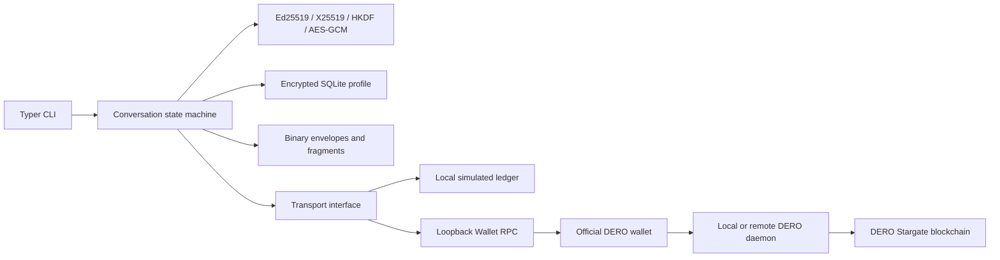

# Architecture

The transport is interchangeable; the protocol never accesses wallet keys. The
real adapter uses only official Wallet RPC. The wallet performs daemon access,
transaction construction, signing, history scanning, and native payload decryption.
No smart contract, messaging server, hosted identity directory, or miner is needed.

## Modules

| Module | Responsibility |
| --- | --- |
| `config.py` | Nonsecret profile settings |
| `crypto.py` | Application primitives and passphrase derivation |
| `protocol.py` | Binary serialization, signature transcripts, RPC wrapping, fragments |
| `storage.py` | Versioned encrypted state and atomic SQLite transactions |
| `conversations.py` | Contacts, handshake, replay protection, inbox/outbox |
| `transport.py` | Simulated ledger and real DERO adapter |
| `rpc.py` | Loopback-only JSON-RPC with bounded responses |
| `wallet.py` | Verified official wallet methods |
| `monitor.py` | Polling and capped recovery backoff |
| `cli.py` | Commands, passphrase prompts, and paid-send confirmation |

## Persistent state

Each independent profile has `config.json` and `state.db`. The configuration includes
its public address, backend, endpoint, confirmation threshold, fee, and Mainnet
send gate. It contains no credentials or application secrets. A schema-version-1
SQLite table stores a random salt and an AES-GCM encrypted JSON snapshot. This
small-PoC choice encrypts keys, plaintext, contacts, replay state, fragments, and
transaction metadata together without relying on SQLite extensions. Reads and
writes use transactions; writes use FULL synchronization. Every encrypted snapshot
has a fresh random 96-bit nonce and fixed schema-specific AAD. Scrypt uses N=32768,
r=8, p=1, a random 16-byte salt, and a 32-byte output. Profile directories are 0700
and database/configuration files 0600. CLI process umask is 077.

`PRAGMA user_version` initializes schema 1 and rejects unknown future schemas. No
migration from another schema is needed yet. Future migrations must explicitly
handle encrypted state, preserve nonce/replay semantics, and never silently reset
identities. Snapshot rewriting is deliberately simple and unsuitable for large
production message archives. Avoid concurrent interactive paid-send commands;
SQLite serializes writes, and a confirmation prompt holds the write lock.

## Sending

1. Resolve a local contact and pinned application identity.
2. Construct a signed handshake or encrypt with a reserved directional counter.
3. Atomically store ciphertext fragments and the updated cryptographic state.
4. Check whether the previous submitted transfer has entered wallet history.
5. Persist a `sending` marker, then submit a fragment. For DERO, check the wallet
   address and destination, enforce the budget, display amount/fee, and ask consent.
6. Store the txid and `submitted` state. Outgoing messages become submitted only
   when all their fragments have txids. Submission does not prove recipient delivery.

A crash after step 5 may leave an uncertain paid transfer. No blind automatic
retry occurs. `chat outbox` shows its state; reconcile wallet history, stop other
profile processes, then explicitly use `chat flush --retry-uncertain` if needed.
The same ciphertext can be paid for twice but cannot decrypt twice at the receiver.
Simulation makes duplicate identical packets idempotent for deterministic recovery.

The real outbox pauses if its prior txid is not yet indexed. `chat flush` resumes
it after indexing; `listen` and `sync` never automatically submit paid transactions.
The official wallet can have its own internal retry behavior; the Python HTTP
client never retries `Transfer` itself.

## Receiving and offline synchronization

1. Obtain wallet block height and incoming transfer history.
2. Apply a configurable confirmation-depth estimate (simulation 1, DERO 10).
3. Deduplicate `(txid, position)` and reconstruct bounded fragment groups.
4. Buffer complete envelopes, process requests/responses, then messages. Data that
   arrived before its acceptance is retained until a subsequent pass can decrypt it.
5. Persist replay state, messages, fragments, observations, and height atomically.

Every sync scans from zero. This is inefficient but avoids gaps due to delayed
wallet indexing and height/topoheight confusion. A failed network request leaves
state untouched. Duplicate confirmed transfers are harmless. The listener retries
network failure with delay capped at 60 seconds and prints events; plaintext is
shown through `chat read`. Nothing received is executed.

There is no deep-reorganization rollback. Once a threshold-confirmed message is
accepted it remains in the local archive even if the transfer later disappears.
Confirmation counts are estimates; a malicious wallet/daemon can lie about history.
A production version needs explicit block-hash reconciliation and finality policy.

## Simulation boundary

The local ledger is a SQLite file shared by Alice and Bob. It stores synthetic
transaction IDs, heights, destinations, and packet bytes; insertion assigns a
monotonic height. Application ciphertext and signatures are real. It does not
simulate DERO consensus, ring proofs, native payload encryption, registration,
fees, network privacy, or reorgs. Wallet labels `sim:alice` and `sim:bob` are not
DERO addresses. No claims about live performance follow from simulation timings.

## Controlled Mainnet probe

`mainnet_probe.py` is an isolated, fixed-proposal transport test using already-running
Wallet RPC instances. It has an Alice/Bob allowlist and a durable one-call, 182-atomic
reservation. Approval is bound to the proposal hash and consumed before submission.
No retry path resets it. Reconciliation reads wallet history and records only probe
metadata and known public probe bytes. It does not access wallet databases or
application session keys. This is a local safeguard, not a boundary against other
unlocked-RPC clients. See `mainnet-validation.md` for the pending authorization.
